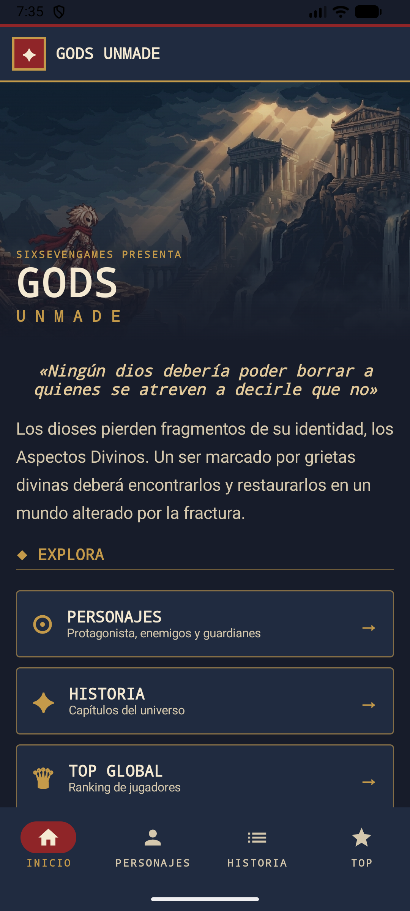
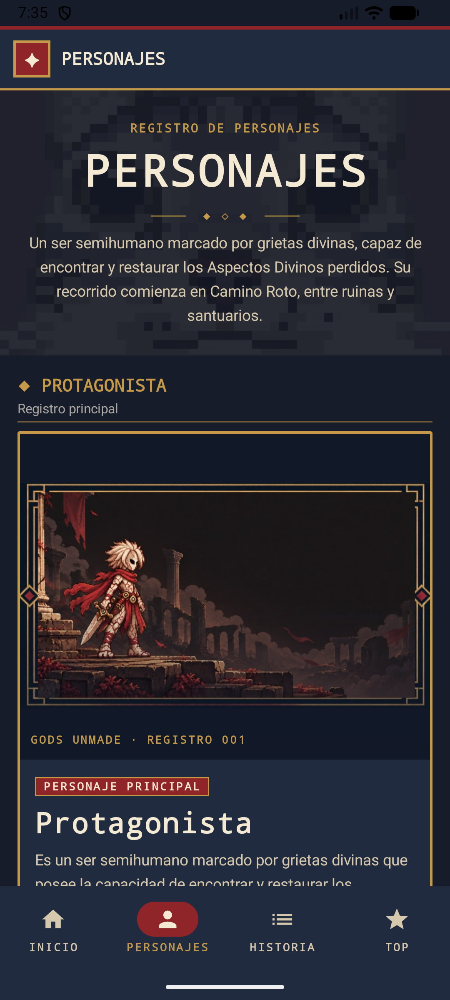
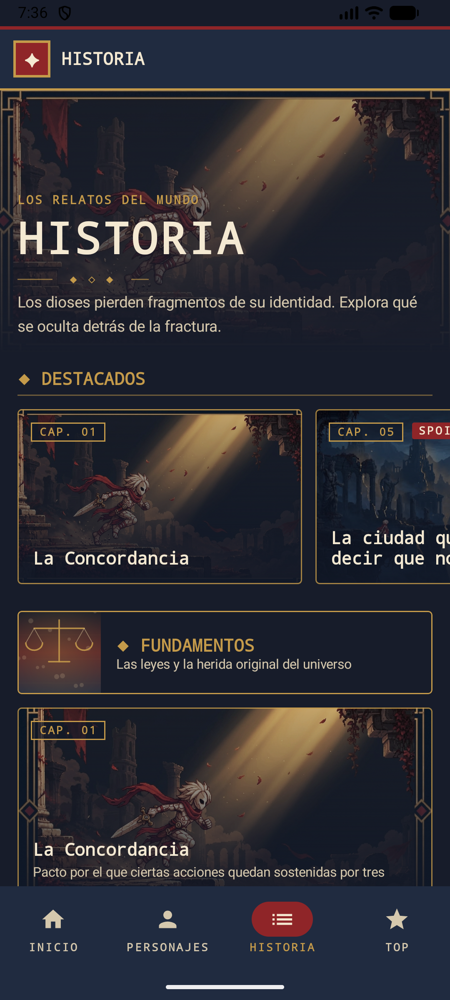

# Gods Unmade (app Android)

Guía complementaria móvil del videojuego *Gods Unmade*. Reúne en cuatro módulos —Inicio, Personajes, Historia y Top Global— el universo del juego: los personajes y enemigos de la web oficial, el relato dividido en 20 capítulos (con advertencia de spoilers) y un ranking de ejemplo. Está hecha en Kotlin con Jetpack Compose y arquitectura MVVM.

| Inicio | Personajes | Historia |
|---|---|---|
|  |  |  |

Documentación completa del diseño: [`docs/5.9_Aplicacion_Movil.md`](docs/5.9_Aplicacion_Movil.md).

## Requisitos
- Dispositivo o emulador con **Android 10 (API 29) o superior**.
- Para compilar: Android Studio reciente (incluye el JDK necesario y el SDK de Android) o un JDK 17+ con el SDK instalado.

## Cómo compilar
1. Clonar el repositorio y abrirlo en Android Studio, o compilar por consola:
   ```powershell
   $env:JAVA_HOME="C:\Program Files\Android\Android Studio\jbr"
   .\gradlew.bat assembleDebug
   ```
2. El APK se genera en `app/build/outputs/apk/debug/app-debug.apk`.
3. Para instalarlo directamente en un dispositivo o emulador conectado: `.\gradlew.bat installDebug`.

## Cómo instalar el APK
1. Descargar `GodsUnmade-v1.0.apk` (carpeta `release/` o la sección *Releases* del repositorio).
2. Copiarlo al teléfono y abrirlo. Android pedirá permitir la instalación desde orígenes desconocidos para la app con la que se abre el archivo.
3. Alternativa con `adb`: `adb install -r release/GodsUnmade-v1.0.apk`.

El APK es de tipo *debug* (suficiente para evaluación).

## Estructura
```
app/src/main/
├── java/com/sixseven/godsunmade/
│   ├── data/        modelos, interfaces de repositorio e implementaciones locales (JSON)
│   ├── ui/          tema, componentes, navegación y pantallas (Screen + ViewModel + UiState)
│   ├── AppContainer.kt   inyección de dependencias manual
│   └── MainActivity.kt
├── assets/          characters.json, story.json, leaderboard.json
└── res/drawable/    imágenes tomadas de la web de referencia
docs/                documentación 5.9, capturas y mockups
release/             APK de evaluación
```

## Conectar una BD / API después
- Los ViewModels solo conocen las interfaces de `data/repository` (`CharactersRepository`, `StoryRepository`, `LeaderboardRepository`).
- Crear `Remote*Repository` (por ejemplo con Retrofit) que devuelvan los mismos modelos de `data/model`.
- Cambiar la implementación en `AppContainer.kt` (ver la cabecera de la clase y los `TODO: conectar a BD/API`). No hay que tocar ViewModels ni UI.
- Añadir el permiso `INTERNET` en el manifest y las dependencias de red en `libs.versions.toml`.

## Contenido
Los JSON de `app/src/main/assets` se generaron a partir de `LORE.md` (lore v1.0, contenido propuesto, no canon definitivo) y de la web de referencia. Para añadir imágenes, copiarlas a `res/drawable` y registrarlas en `drawableFor()` (`ui/components/Decor.kt`).
