# 5.9 Aplicación móvil: diseño y entrega

Como complemento del videojuego *Gods Unmade* se desarrolló una aplicación móvil nativa para Android que funciona como guía del universo del juego. La aplicación reúne, en cuatro módulos, la información que la web oficial presenta de forma dispersa: una pantalla de inicio, el registro de personajes, el relato dividido en capítulos y un ranking de jugadores. Esta sección describe su diseño, sus pantallas, su arquitectura y la forma de obtener el código y el instalador.

## Mockups y diseño de pantallas

El diseño visual reproduce la identidad de la web del juego: tema oscuro con fondo azul noche (#171C2A), superficies #202B40, acento rojo arcilla (#8F2528), detalles en bronce (#C49A4A) y texto en tonos lino (#F4E9D2 y #D5C8AD). Los títulos usan tipografía monoespaciada, como la web, y el cuerpo de texto una tipografía sans del sistema. Las capturas que se muestran fueron tomadas de la aplicación real ejecutándose en un emulador de Android 10 o superior; los marcos de teléfono se añadieron después únicamente con fines de presentación.

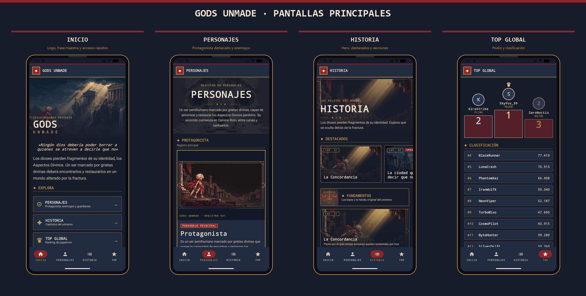

*Figura 5.9.1 Pantallas principales de la aplicación: Inicio, Personajes, Historia y Top Global.*

La navegación se organiza con una barra inferior de cuatro destinos de nivel superior. Desde Personajes se accede al detalle de cada personaje y desde Historia al detalle de cada capítulo; cuando el capítulo contiene spoilers, se muestra primero una advertencia que el lector debe aceptar. Las pantallas de detalle ocultan la barra inferior y ofrecen una flecha para regresar.

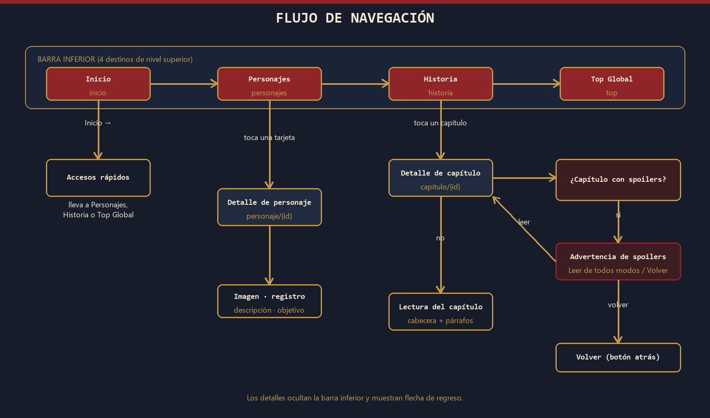

*Figura 5.9.2 Diagrama del flujo de navegación de la aplicación.*

### Inicio

Presenta la portada del juego, la frase maestra, una breve sinopsis y tres accesos rápidos a las demás secciones. Incluye un aviso discreto que indica que el lore es una propuesta (v1.0) y no un canon definitivo.

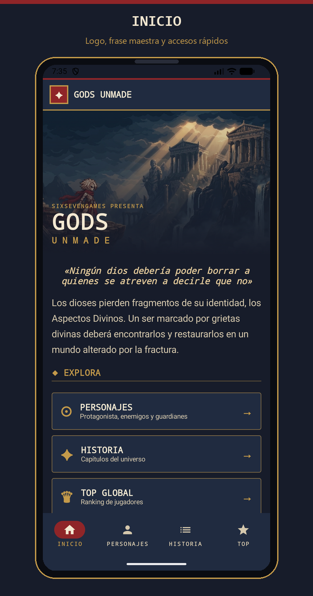

*Figura 5.9.3 Pantalla de Inicio.*

### Personajes

Muestra el registro de personajes de la web: una tarjeta destacada para el protagonista y cuatro tarjetas para los enemigos y guardianes, entre ellas el Custodio, identificado como jefe de la demo.

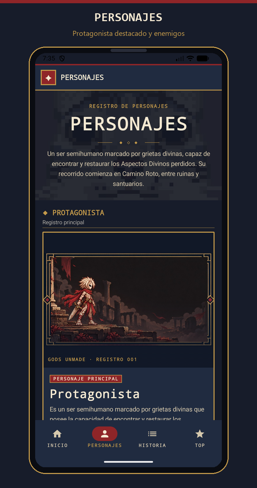

*Figura 5.9.4 Lista de personajes con el protagonista destacado.*

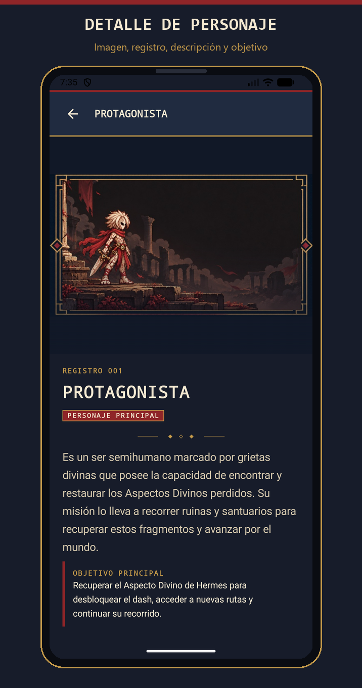

*Figura 5.9.5 Detalle del protagonista (imagen, registro, descripción y objetivo principal).*

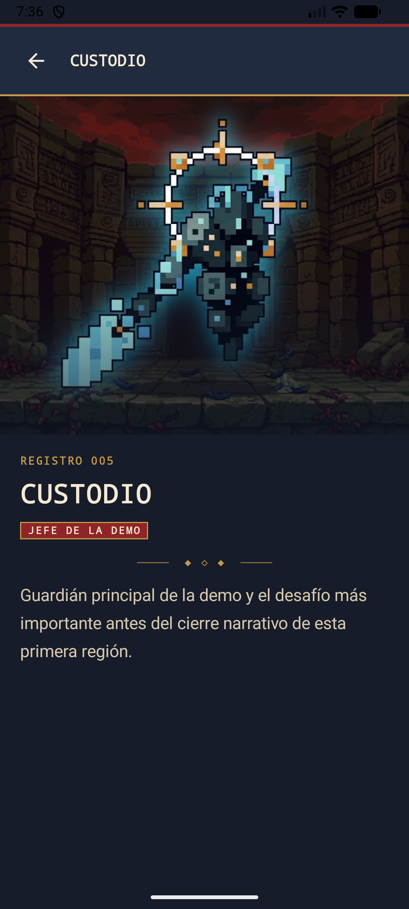

*Figura 5.9.6 Detalle del Custodio, jefe de la demo.*

### Historia

Ofrece una portada ilustrada, una fila horizontal de capítulos destacados y el listado completo agrupado en cuatro secciones, cada una con un encabezado ilustrado. Los capítulos con spoilers llevan una etiqueta visible.

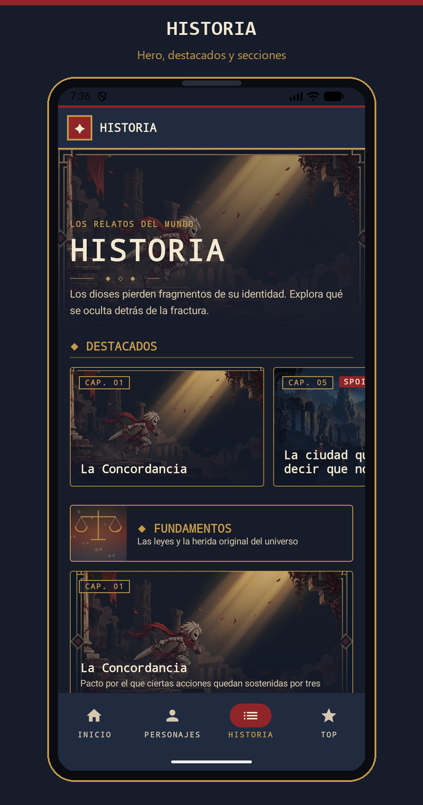

*Figura 5.9.7 Pantalla de Historia con portada, destacados y secciones.*

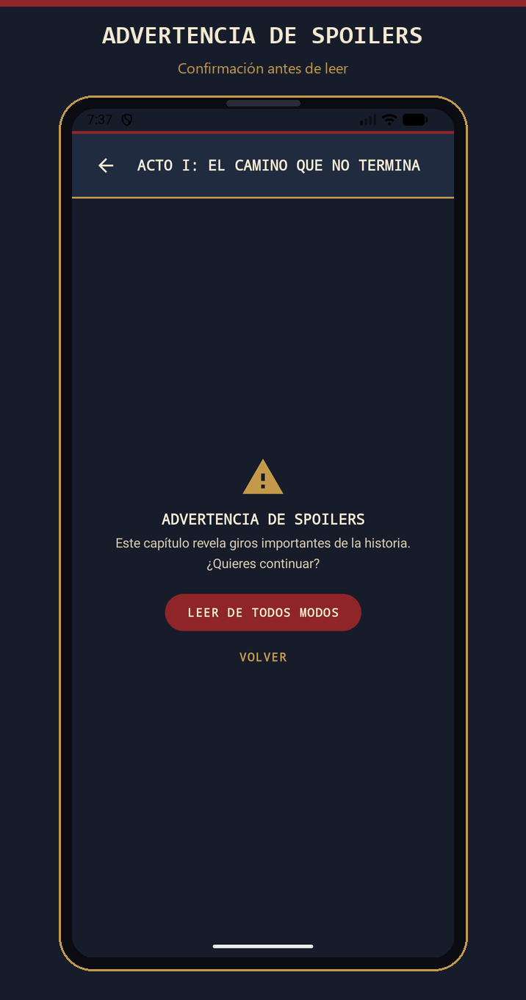

*Figura 5.9.8 Advertencia de spoilers previa a la lectura de un capítulo.*

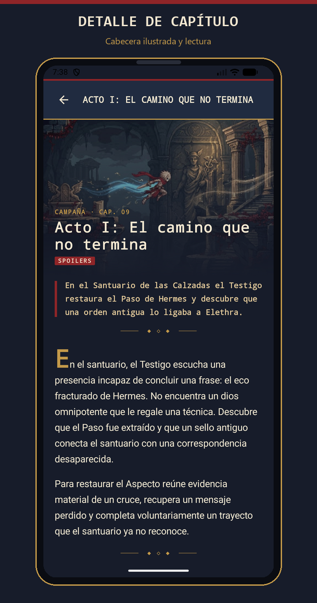

*Figura 5.9.9 Detalle de un capítulo con ilustración de la web (cabecera, cita destacada, inicial grande y separadores).*

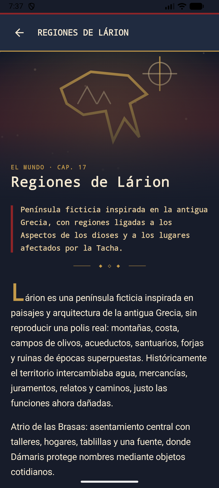

*Figura 5.9.10 Detalle de un capítulo con arte generado con Compose (símbolo de mapa).*

### Top Global

Presenta un podio con los tres primeros lugares y la clasificación restante en forma de lista. Los datos son ficticios y locales, a la espera de conectar una base de datos.

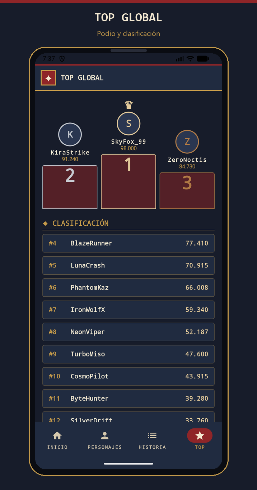

*Figura 5.9.11 Pantalla de Top Global con podio y clasificación.*

## Descripción de módulos

### Arquitectura y tecnologías

La aplicación sigue el patrón MVVM. Cada pantalla se compone de un composable de interfaz que recibe un estado inmutable y callbacks (elevación de estado), un ViewModel que expone ese estado como StateFlow y una interfaz sellada UiState con los casos Loading, Success y Error. Los ViewModels no acceden a los datos directamente, sino a través de interfaces de repositorio (CharactersRepository, StoryRepository y LeaderboardRepository), cuya implementación actual (Local*Repository) lee archivos JSON incluidos en la carpeta assets. Un contenedor de dependencias manual (AppContainer) decide qué implementación se utiliza, de modo que, para conectar una API o una base de datos, basta con crear implementaciones remotas y sustituirlas en ese único punto, sin modificar ViewModels ni interfaz.

| Tecnología | Versión | Uso en el proyecto |
|---|---|---|
| Kotlin | 2.2.10 | Lenguaje principal |
| Jetpack Compose (BOM) | 2026.02.01 | Interfaz declarativa |
| Material 3 | incluida en el BOM | Componentes y tema oscuro |
| Navigation Compose | 2.9.6 | Barra inferior y rutas de detalle |
| Lifecycle (ViewModel y runtime Compose) | 2.11.0 | ViewModel, StateFlow y collectAsStateWithLifecycle |
| kotlinx.serialization (JSON) | 1.9.0 | Lectura de los JSON de assets |
| Coil | 3.3.0 | Declarada como dependencia; las imágenes actuales (recursos locales) se cargan con painterResource |
| Android Gradle Plugin | 9.4.1 | Compilación |
| SDK de Android | minSdk 29, targetSdk 37 | Android 10 o superior |

### Módulo Inicio

- **Propósito:** Dar la bienvenida al usuario, presentar el juego y servir de punto de entrada a las demás secciones.
- **Información presentada:** Portada ilustrada con el título «GODS UNMADE», la frase maestra («Ningún dios debería poder borrar a quienes se atreven a decirle que no»), una sinopsis breve, tres tarjetas de acceso (Personajes, Historia y Top Global) y el aviso «Lore v1.0, contenido propuesto».
- **Acciones disponibles:** Desplazarse por la pantalla y tocar una de las tres tarjetas de acceso.
- **Navegación:** Es el destino inicial de la aplicación. Cada tarjeta lleva al destino de nivel superior correspondiente; también puede usarse la barra inferior.
- **Componentes y ViewModel/UiState:** Usa AppTopBar, SectionTitle y AppBottomBar, además de tarjetas de acceso propias de la pantalla. HomeViewModel expone un HomeUiState (Loading, Success con frase, sinopsis y aviso, o Error); el contenido es estático y no depende de repositorio.

### Módulo Personajes (lista)

- **Propósito:** Presentar el registro de personajes de la web: el protagonista y los enemigos y guardianes.
- **Información presentada:** Cabecera «Registro de personajes» con una breve introducción; tarjeta destacada del protagonista (imagen, etiqueta «Personaje principal», descripción y bloque «Objetivo principal»); sección «Enemigos y guardianes» con cuatro tarjetas (Minotauro, Arpía, Medusa y Custodio) que muestran imagen, número de registro, nombre y descripción. El Custodio lleva la etiqueta «Jefe de la demo». En total son cinco personajes, tomados de la web de referencia.
- **Acciones disponibles:** Desplazarse por la lista, tocar una tarjeta para ver su detalle y, si la carga falla, pulsar «Reintentar». La pantalla no incluye búsqueda ni filtros.
- **Navegación:** Se llega desde la barra inferior o desde el acceso de Inicio; al tocar una tarjeta se navega a la ruta personaje/{id}.
- **Componentes y ViewModel/UiState:** Componentes: LoreHeader, SectionTitle, FeaturedCharacterCard, CharacterCard, CharacterAvatar, RegistroLabel, TagLabel y ObjectiveBlock. CharactersViewModel expone CharactersUiState (Loading, Success con el protagonista y la lista de enemigos, o Error) y consulta CharactersRepository, implementado por LocalCharactersRepository a partir de characters.json.

### Módulo Personajes (detalle)

- **Propósito:** Mostrar la ficha completa de un personaje.
- **Información presentada:** Imagen grande, número de registro, nombre, etiqueta (si existe), separador decorativo, descripción y, solo para el protagonista, el objetivo principal.
- **Acciones disponibles:** Desplazarse por la ficha, volver con la flecha de la barra superior y reintentar si ocurre un error.
- **Navegación:** Se llega desde la lista de personajes. Oculta la barra inferior y regresa a la lista.
- **Componentes y ViewModel/UiState:** CharacterDetailViewModel recibe el identificador de la ruta mediante SavedStateHandle y emite CharacterDetailUiState (Loading, Success con el personaje o Error). Reutiliza CharacterAvatar, RegistroLabel, TagLabel, ObjectiveBlock y OrnamentDivider.

### Módulo Historia (lista)

- **Propósito:** Dar acceso al relato del universo organizado por secciones y capítulos.
- **Información presentada:** Portada ilustrada con el título; fila horizontal de seis capítulos destacados; cuatro secciones (Fundamentos, Campaña, Desenlace y El mundo) con encabezado ilustrado; y 20 tarjetas de capítulo con número, título y resumen sobre una imagen o un arte generado. Nueve capítulos llevan la etiqueta «Spoilers». Seis capítulos usan imágenes de la web y catorce usan arte generado con Compose (ChapterArt).
- **Acciones disponibles:** Desplazarse verticalmente, desplazar la fila de destacados horizontalmente, tocar un capítulo y reintentar en caso de error.
- **Navegación:** Se llega desde la barra inferior o desde el acceso de Inicio; al tocar un capítulo se navega a capitulo/{id}.
- **Componentes y ViewModel/UiState:** Componentes: StoryChapterCard, StorySectionHeader, SpoilerBadge, ChapterVisual, ChapterArt, SectionTitle y OrnamentDivider. StoryViewModel expone StoryUiState (Loading, Success con destacados y secciones agrupadas, o Error) y consulta StoryRepository, implementado por LocalStoryRepository a partir de story.json.

### Módulo Historia (detalle de capítulo y advertencia de spoilers)

- **Propósito:** Permitir la lectura cómoda de un capítulo, avisando antes si revela giros importantes de la historia.
- **Información presentada:** Si el capítulo tiene spoilers, primero aparece una advertencia con los botones «Leer de todos modos» y «Volver». Una vez aceptada, se muestra una cabecera a todo el ancho (imagen o arte), la sección y número del capítulo, el título, una cita destacada con el resumen, la primera letra del texto ampliada y los párrafos separados por el ornamento ◆ ◇ ◆.
- **Acciones disponibles:** Aceptar o rechazar la advertencia, desplazarse por el texto (la cabecera se desvanece y se desplaza con efecto de paralaje) y volver con la flecha superior.
- **Navegación:** Se llega desde la lista de historia y regresa a ella. La aceptación de la advertencia se mantiene mientras el detalle está abierto; al salir y volver a entrar, se solicita de nuevo.
- **Componentes y ViewModel/UiState:** ChapterDetailViewModel obtiene el identificador mediante SavedStateHandle, emite ChapterUiState (Loading, Success con el capítulo y el indicador spoilerAceptado, o Error) y expone aceptarSpoiler(). Usa SpoilerWarning, SpoilerBadge, ChapterVisual y OrnamentDivider.

### Módulo Top Global

- **Propósito:** Mostrar el ranking de jugadores.
- **Información presentada:** Un podio con los tres primeros puestos (se muestran en el orden visual 2.º, 1.º y 3.º, con una corona sobre el primero) y, debajo, la clasificación del cuarto al decimoctavo lugar con nombre y puntaje. Los 18 jugadores son datos ficticios locales.
- **Acciones disponibles:** Desplazarse por la clasificación y reintentar en caso de error. No existe detalle de jugador.
- **Navegación:** Se llega desde la barra inferior o desde el acceso de Inicio; no enlaza a otras pantallas.
- **Componentes y ViewModel/UiState:** Componentes: PodiumItem, LeaderboardRow, SectionTitle y EmptyView. LeaderboardViewModel expone LeaderboardUiState (Loading, Success con podio y resto, o Error) y consulta LeaderboardRepository, implementado por LocalLeaderboardRepository a partir de leaderboard.json.

## Código fuente y APK

El código fuente completo se encuentra en el repositorio de GitHub: https://github.com/ElNyankai/gods-unmade-android. El código incluye comentarios KDoc en español en las clases, ViewModels, repositorios y composables públicos, así como cabeceras explicativas en AppContainer y AppNavHost que describen cómo migrar a una API o base de datos.

Estructura resumida de carpetas:

```
app/src/main/
  java/com/sixseven/godsunmade/
    data/          model, repository (interfaces) y local (implementaciones JSON)
    ui/
      theme/       Color, Type y Theme tomados de la web
      components/  componentes reutilizables (barras, tarjetas, ChapterArt...)
      navigation/  AppNavHost y rutas
      home/ characters/ story/ leaderboard/   Screen + ViewModel + UiState
    AppContainer.kt   inyección de dependencias manual
    MainActivity.kt
  assets/          characters.json, story.json, leaderboard.json
  res/drawable/    imágenes de la web de referencia
docs/              esta documentación, capturas y mockups
release/           APK de evaluación (GodsUnmade-v1.0.apk)
```

El instalador (APK de tipo debug, suficiente para evaluación, para dispositivos con Android 10 o superior) se publicará como Release del repositorio. Enlace: [PENDIENTE: URL del APK, se publicará como Release en https://github.com/ElNyankai/gods-unmade-android/releases]. Mientras tanto, el archivo se incluye en el repositorio en la ruta release/GodsUnmade-v1.0.apk.
